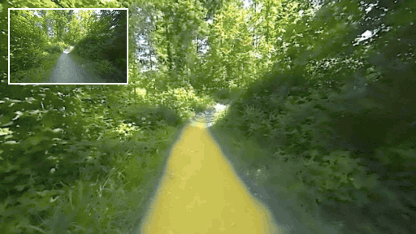
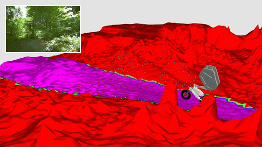
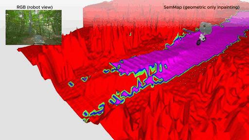
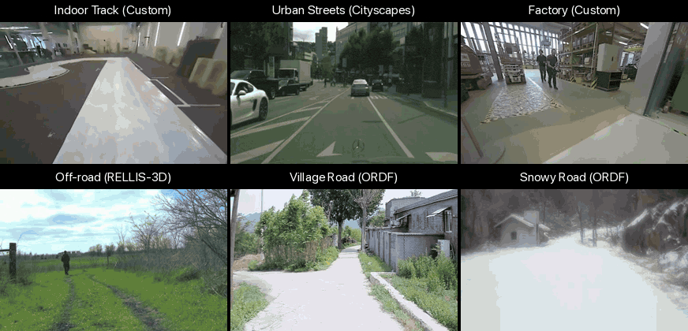
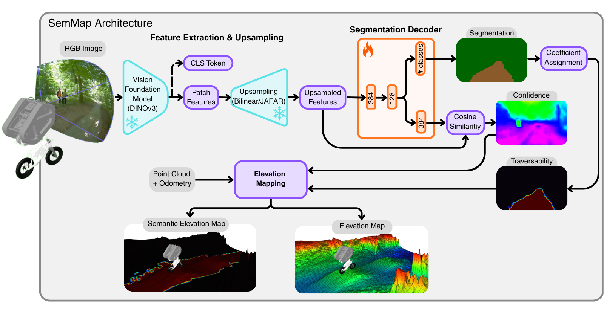
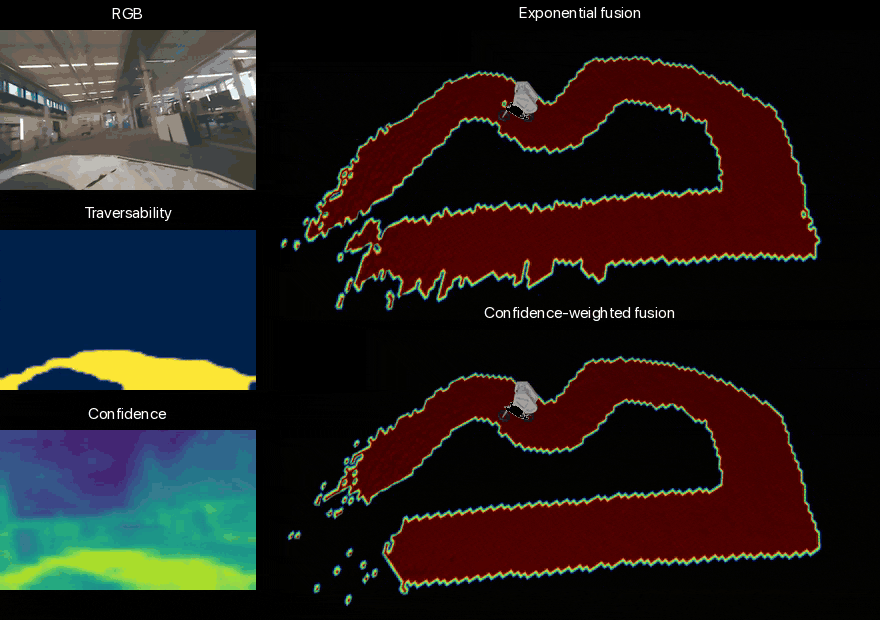

<!-- Copyright (c) 2026 Robotics and AI Institute LLC dba RAI Institute. All rights reserved. -->

# SemMap 🗺️

Semantic traversability maps for ultra-mobile robots, fully onboard and in real
time. From a camera stream, SemMap predicts per-pixel **segmentation**,
**traversability** (how drivable each pixel is) and **confidence**, then fuses
traversability with a point cloud into a **2.5D semantic elevation map**.

- **Fast:** up to about 90 Hz on a Jetson AGX Orin
  ([Paper settings](#paper-settings)). In the paper, its map was the policy's
  only view of the terrain as a bicycle robot raced 959 m of real mountain
  bike trail, with no offboard compute and no prior map.
- **Quick to adapt:** a frozen [DINOv3](https://github.com/facebookresearch/dinov3)
  backbone with a decoder of about 100,000 parameters. Only the decoder is
  trained: about 20 labelled images and a few minutes on the Orin.
- **Not tied to one robot:** trained mostly from a handheld camera, and run on
  a bicycle robot, quadruped data and a humanoid. A camera alone gives the
  image outputs (`config/robots/camera_only.yaml`); add a pose and a point
  cloud for the map.

Research code for the paper *"Autonomous trail racing and parkour with a
bicycle robot"*, where it was part of the perception stack.

<table>
  <tr>
    <td align="center">
      <br>
      <b>Traversability on RGB</b>
    </td>
    <td align="center">
      <br>
      <b>Semantic elevation map</b>
    </td>
    <td align="center">
      <br>
      <b>Semantic inpainting</b>
    </td>
  </tr>
  <tr>
    <td align="center" colspan="3">
      <br>
      <b>Traversability across six datasets</b>
    </td>
  </tr>
</table>

> **Maintenance:** provided as-is, best-effort only. No feature development or
> long-term support. See [CONTRIBUTING.md](CONTRIBUTING.md).
>
> **Licence:** non-commercial research use only, under the
> [RAI Institute Research License](LICENSE). See [Licence](#licence).

## What's included

The ROS 2 package (a C++ node running a Python pipeline), the model export
tools and the adaptation tools. Not included: internal robot configs,
deployment settings and the paper's evaluation code. The demo uses the public
GrandTour dataset rather than the paper's robot recordings.

## How it works

<p align="center">
  
</p>

The decoder has two heads: one predicts a probability per class for each
pixel, the other rebuilds the features it was given.

- **Segmentation** is the most likely class.
- **Traversability** averages a score per class, from 0 (obstacle) to 1
  (drivable), weighted by the class probabilities: a pixel that is 60% trail
  and 40% rock scores 0.6. Lower `traversability_temperature` pushes pixels
  towards their most likely class.
- **Confidence** is the cosine similarity between the given and rebuilt
  features. Low confidence means the input looks unlike the training data.

Class scores live in `config/seg_layers/`, apart from the model, so one model
can be scored differently per robot.

For the 2.5D map, the point cloud and pose build an elevation map, and
traversability is projected onto it through the camera pose and calibration.
`semantic_fusion_method` sets how repeated views merge: `exponential` blends
each view in at a fixed rate; `confidence_weighted` lets confident cells resist
weak updates, which keeps the map clean on loops like the indoor track below.

<p align="center">
  
</p>

## Requirements

| | |
|---|---|
| Hardware | x86_64 with an NVIDIA GPU, or Jetson AGX Orin on JetPack 6 or 7 |
| OS | Ubuntu 22.04 and ROS 2 Humble inside the container; the host needs only Docker |
| CUDA / TensorRT | 12.8 / 10.8.0 desktop, 12.6 / 10.7.0 Jetson (see [Limitations](#limitations)) |
| Reference platform | AGX Orin, as in the paper |

Everything else is in the container; the host needs only Docker and the
[NVIDIA Container Toolkit](https://docs.nvidia.com/datacenter/cloud-native/container-toolkit/latest/install-guide.html).

## Quick start

```bash
git clone https://github.com/rai-opensource/sem_map.git
cd sem_map

xhost +local:docker            # for RViz windows, once per login

docker compose --profile desktop build      # 30-60 min the first time
docker compose --profile desktop up -d
docker compose --profile desktop exec sem_map-desktop bash
```

The container runs as UID/GID 1000:1000, so the files it writes are yours on
the host. If your user differs, pass your IDs at build time:

```bash
docker compose --profile desktop build \
    --build-arg HOST_UID=$(id -u) --build-arg HOST_GID=$(id -g)
```

Inside the container:

```bash
source scripts/setup_env.sh    # ROS 2, networking, build settings
./scripts/verify.sh            # check GPU, CUDA, TensorRT, PyTorch
colcon build                   # from the repository root
source install/setup.bash

scripts/artifacts/download.sh                            # get the models
python scripts/sem_map/cli/run_export_all_trt.py --fp16  # optimise for this GPU
```

On a Jetson, use `--profile agx` and run `./scripts/enable_max_mode.sh` on the
host for full clocks.

### Settings you may need to change

`setup_env.sh` handles both of these, but it helps to know:

- **Build:** `colcon build` reads `colcon-defaults.yaml`. Run it from the
  repository root, or the build is slow and unoptimised.
- **Networking:** `setup_env.sh` switches ROS 2 from FastDDS to CycloneDDS,
  which handles images and point clouds better. Set `SEM_MAP_DDS=fastdds` or
  `zenoh` to change it, and `ROS_DOMAIN_ID` to keep robots on one network apart.

To stream images or point clouds between machines, raise the network buffer
limit on the host (not in the container):

```bash
sudo sysctl -w net.core.rmem_max=10485760
```

## Try the demo

Full walkthrough on public data: [docs/GRANDTOUR.md](docs/GRANDTOUR.md).

```bash
# Download a mission (free account at the GrandTour dataset site)
python tools/grandtour/mission_cli.py SNOW-2 --download \
    --dest data/public_datasets/grandtour --convert-to-ros2

# Two terminals
ros2 launch sem_map sem_map_replay.launch.py robot:=grandtour_real
ros2 bag play --clock -s mcap data/public_datasets/grandtour/SNOW-2/*zed2i_images.mcap
```

It works if `ros2 topic hz /sem_map/traversability` shows messages while the
bag plays. RViz shows the output.

## Use it on your own robot

SemMap does not start your camera. Run your usual driver, find its topics with
`ros2 topic list`, and point SemMap at them:

```bash
# Any camera that publishes an image and a CameraInfo
ros2 launch sem_map sem_map_camera.launch.py \
    image_topic:=/camera/color/image_raw \
    camera_info_topic:=/camera/color/camera_info \
    image_width:=1280 image_height:=720

# From a recording
ros2 launch sem_map sem_map_replay.launch.py robot:=<name>
ros2 bag play --clock -s mcap <bag.mcap>

# Replay and record the results together
ros2 launch sem_map sem_map_replay_record.launch.py bag:=<bag.mcap> robot:=<name>

# ZED, with the driver started for you (needs INSTALL_ZED=true at build time)
ros2 launch sem_map sem_map_zed.launch.py camera_model:=zedx
```

To skip the long command lines, copy `config/robots/camera_only.yaml` to
`config/robots/<name>.yaml`, fill in your topics and frames, and use
`robot:=<name>`. Robot files override `config/sem_map.yaml`; command-line
arguments override both.

For the 2.5D map, add a pose and a point cloud:

```bash
ros2 launch sem_map sem_map_camera.launch.py \
    image_topic:=/camera/color/image_raw \
    camera_info_topic:=/camera/color/camera_info \
    pose_topic:=/odom/pose pointcloud_topic:=/lidar/points \
    world_frame:=odom base_frame:=base_link pose_frame:=base_link
```

### Topics

Inputs (names configurable):

| Topic | Type | Needed for |
|---|---|---|
| `image_topic` | `Image` or `CompressedImage` | everything |
| `camera_info_topic` | `CameraInfo` | everything |
| `pose_topic` | `PoseStamped`, or `Odometry` with `pose_is_odometry: true` | the BEV map |
| `pointcloud_topic` | `PointCloud2` | the elevation map |
| `/tf`, `/tf_static` | | sensor positions |

Outputs:

| Topic | Type | Description |
|---|---|---|
| `/sem_map/traversability` | `Image` | how drivable each pixel is |
| `/sem_map/segmentation` | `Image` | class per pixel |
| `/sem_map/confidence` | `Image` | how sure the model is |
| `/sem_map/grid_map` | `GridMap` | the 2.5D map |
| `/sem_map/map_center` | `PoseStamped` | where the map is centred |
| `/sem_map/stats` | `DiagnosticArray` | timing per stage |

The default launch files run the C++ node; `sem_map_py.launch.py` runs a
Python-only version that publishes `/sem_map/trav_map` and `/sem_map/pointcloud`
instead of the segmentation, confidence and stats topics.

### Frames

Set in your robot config:

- `world_frame`: fixed and gravity-aligned; the map is published in it.
- `base_frame`: the robot body; point clouds are converted into it.
- `pose_frame`: what `pose_topic` reports, assumed (not checked) to be in
  `world_frame`.

Sensor positions are read from TF once, on the first message, so TF must be
right at startup and stay fixed. Poses are interpolated to camera timestamps;
frames too late for the stored poses are dropped, and a backwards time jump (a
looping recording) discards everything in flight.

## Adapt it to a new place

The tool takes you from raw footage to a working model; around 20 labelled
images is usually enough. In the paper, 20 trail images reached 82.6% mIoU (90.0% with all 28,763), and
on RELLIS-3D beat fully fine-tuned DeepLabV3+ and SegFormer-B0 (33.9% against
about 24%). Recording to exported model took under 15 minutes on the Orin,
1.5 to 3 of them training.

```bash
python scripts/sem_map/cli/pipeline_train_tui.py
```

Steps (also in `scripts/sem_map/cli/pipeline_steps.py`):

1. **Extract** images from a recording or video.
2. **Pick** a varied subset to label and split it into training and
   validation; variety is what keeps the label count small.
3. **Filter classes** (optional): a vision language model drops classes that
   never appear. Needs `SEM_MAP_LLM_*`; see `scripts/setup_env.sh`.
4. **Label** with SAM 3 from the `concept:` text in your class file; review and
   correct with `scripts/sem_map/notebooks/sam3_*_app.py`.
5. **Train** the decoder.
6. **Export** it and build a TensorRT engine for your GPU.

To register the result, copy `config/seg_layers/template.yaml`, describe your
classes, add a line to `config/models.yaml`, and select it with `seg_layer:` in
your robot config.

Other tools:

| Command | What it does |
|---|---|
| `cli/pipeline_inference_tui.py` | run a model over a video and save the result |
| `cli/profile_model.py` | measure speed and memory use |
| `cli/onnx_inspect.py`, `cli/onnx_benchmark.py` | inspect and time model files |
| `cli/run_export_all_onnx.py`, `cli/run_export_all_trt.py` | export everything at once |

## Models

Models live on the Hugging Face Hub, not in git; `scripts/artifacts/download.sh`
fetches them:

| Model | For |
|---|---|
| `dinov3s_backbone` | the shared feature extractor |
| `dinov3s_sem_seg_snow_v1` | the GrandTour snow demo |
| `dinov3s_sem_seg_trail_v4` | forest trails |
| `dinov3s_jafar_x{2,4,8,16}` | optional sharper output (`--jafar`) |

They work on x86 and Jetson. TensorRT engines are not distributed, since each
runs only on the GPU and TensorRT version it was built on;
`run_export_all_trt.py` builds them locally.

> **Licensing:** the models are **not** covered by this repository's licence.
> The backbone and everything trained on it fall under the
> [DINOv3 licence](MODEL_LICENSES/DINOv3_LICENSE.md): it must stay with the
> files, anything derived from them stays under it, and it forbids military,
> weapons, nuclear, espionage and ITAR-controlled use. The optional sharpening
> model is Apache-2.0.

Exporting the models yourself needs access to the gated
`facebook/dinov3-vits16-pretrain-lvd1689m` on Hugging Face (`hf auth login`),
and auto-labelling needs the gated `facebook/sam3`. Request both, then run
`scripts/artifacts/download_training_models.sh` (`--check` lists what is
cached without downloading).

Re-exporting JAFAR also needs its upstream code and weights, which are not on
the Hub: clone [JAFAR](https://github.com/PaulCouairon/JAFAR) into
`external/JAFAR` (or set `JAFAR_ROOT`) and put
[`vit_small_patch16_dinov3.lvd1689m.pth`](https://github.com/PaulCouairon/JAFAR/releases/download/Weights/vit_small_patch16_dinov3.lvd1689m.pth)
in its `output/jafar/`.

## Paper settings

The defaults favour a quick start: bilinear upsampling (no extra model),
exponential fusion, no inpainting, and a 20 m map at 0.25 m. For the paper's
trail setup, add this to your robot config in `config/robots/`:

```yaml
/**:
  ros__parameters:
    # JAFAR x4: download.sh --jafar, then run_export_all_trt.py.
    upsampler_type: "jafar_partial"
    upsample_partial_factor: 4

    # Weight by confidence and distance; skip pixels below 0.5.
    semantic_fusion_method: "confidence_weighted"
    conf_floor: 0.5
    conf_weight_cap: 4.0

    # Fill hidden cells from neighbours, height and traversability together.
    enable_inpaint: true

    # 15 x 15 m at 0.1 m.
    map_size: 15.0
    resolution: 0.1
```

Measured in the paper on an AGX Orin 64GB (MAXN, TensorRT FP16, 320×512):

| Upsampling | Per frame | ORFD mIoU |
|---|---|---|
| bilinear (default) | 6.1 ms, ~163 Hz | 83.8% |
| JAFAR ×4 (paper) | 11.1 ms, ~90 Hz | 87.9% |

This is the semantic pipeline alone, from an image already on the GPU, without
ROS transport or mapping, so an upper bound. On the robot, camera and map ran at
30 Hz. Measure your GPU with `scripts/sem_map/cli/profile_model.py`.

## Limitations

- **TensorRT is pinned:** 10.8.0 on desktop, 10.7.0 on Jetson, because version
  11 removed options this code uses. They differ because Blackwell (sm_120)
  needs 10.8 and CUDA 12.8, while JetPack 6 is on CUDA 12.6; both are 10.x with
  the same API. Override the desktop pin with the `TRT_PIN_VERSION` build arg.
- **No Maxwell or Pascal desktop GPUs.** The desktop image uses CUDA 12.8
  (cu128) wheels for Blackwell, which ship sm_70 and newer; sm_50/sm_60 cards
  need the older cu126 wheels.
- **`scripts/verify.sh` only checks that CUDA initialises**, not that kernels
  run, so it prints `CUDA: True` even on an unsupported GPU.
- **Tested only** on x86_64 with an NVIDIA GPU and on Jetson AGX Orin with
  JetPack 6.2.1 and 7.2.1. JetPack 7 uses the same JetPack 6 image. Jetson Thor
  is untested.
- **Timing:** poses must arrive faster than camera frames, and sensor clocks
  must roughly agree. Use `--clock` when replaying.
- **Calibration** comes from `camera_info` and TF, read once at startup.
- **Models are environment-specific:** one trained on snow does poorly in a
  forest. Retraining is cheap, which is the point.
- **Results vary:** speed depends on your GPU and its temperature, and training
  is random.
- The paper's measurements used recordings not in this release.

## Repository layout

```text
config/            settings: node, robot, classes, elevation map, camera
docker/            container image and dependency lists
docs/              demo walkthrough
include/, src/     the C++ ROS 2 node
launch/            launch files
scripts/sem_map/   the Python pipeline, tools and training code
scripts/artifacts/ model download and upload
tools/             recording and dataset helpers
```

The repository is the ROS 2 package, so there is no workspace to set up. For
the training tools without ROS, `pip install -e ".[pytorch,vit,tools]"`;
`.[tools]` alone gives only the dataset and labelling helpers.

## Versioning

Version `0.1.0`; interfaces may change. Models are versioned separately on the
Hub and linked to the code by `config/models.yaml`, so they can change without
a code release.

## Contributing

Bug reports and fixes are welcome; new features are unlikely to be picked up.
See [CONTRIBUTING.md](CONTRIBUTING.md). Before opening a pull request:

```bash
pip install pre-commit && pre-commit install
pre-commit run --all-files
```

## Citation

> Autonomous trail racing and parkour with a bicycle robot.
> Fabian Jenelten\*, Deepana Ishtaweera\*, Pablo Garcia, Liana Margolese, Igor
> Bogoslavskyi, Luca Buonocore, Jan Migliazza, Aleksandrs Ecins, Annika
> Wollschlaeger, Dario Bellicoso, Gabriel Nelson, Abel Gawel, Marco Hutter.
>
> \* Equal contribution.

The paper is under submission; full details and BibTeX will follow on
publication.

## Credits

SemMap was developed by **Deepana Ishtaweera** (<dishtaweera@rai-inst.com>) at
the Robotics and AI Institute and the Robotic Systems Lab, ETH Zurich, as part
of a master's thesis supervised by **Abel Gawel**, **Fabian Jenelten** and
**Marco Hutter**, as one component of the trail racing system in the paper
above.

Built on [DINOv3](https://github.com/facebookresearch/dinov3),
[JAFAR](https://github.com/PaulCouairon/JAFAR),
[SAM 3](https://huggingface.co/facebook/sam3),
[elevation_mapping_cupy](https://github.com/leggedrobotics/elevation_mapping_cupy_core)
and [grid_map](https://github.com/ANYbotics/grid_map).

## Licence

The code is under the [RAI Institute Research License](LICENSE): use, modify
and redistribute it for non-commercial research only, keeping the copyright
notice and licence text, and clearly mark modified versions. For-profit
organisations may use it under the same research-only condition.

Exceptions: a few functions copied from
[JAFAR](https://github.com/PaulCouairon/JAFAR) and one configuration file
adapted from `rmw_zenoh` (both Apache-2.0), and two configuration files adapted
from `elevation_mapping_cupy` (MIT). [NOTICE](NOTICE) lists them; their licence
texts are in [licenses/](licenses/).

The models have their own terms; see [Models](#models). Libraries SemMap builds
and runs against come from their own sources under their own licences, none of
them copyleft, and are not redistributed here.
